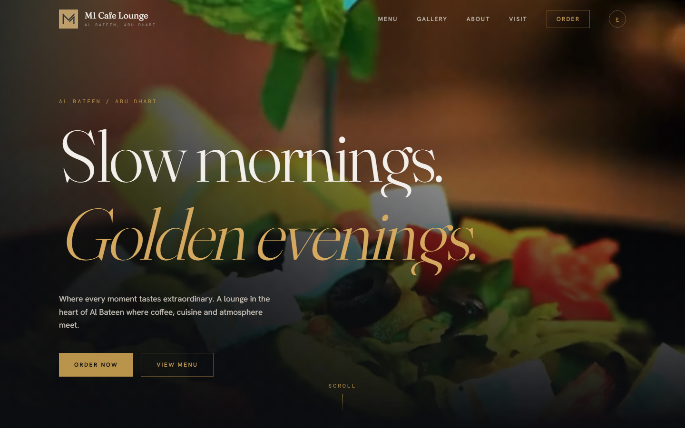

# M1 Cafe Lounge

Bilingual (English and Arabic) website for M1 Cafe Lounge in Al Bateen, Abu Dhabi.

**Live:** [m1cafe.farukportfolio.live](https://m1cafe.farukportfolio.live)



## Features

- English and Arabic with a language toggle and full right-to-left layout
- Separate Arabic display and body fonts (El Messiri, Tajawal)
- Video hero with a staggered headline reveal
- Menu, gallery, reviews, about and location sections
- Order and WhatsApp buttons, plus a sticky mobile call-to-action bar
- Magnetic buttons and scroll-triggered reveals
- Smooth scroll with Lenis, synced to GSAP ScrollTrigger

## Stack

- Next.js 16 (App Router), React 19, TypeScript
- Tailwind CSS v4
- GSAP + ScrollTrigger
- Lenis
- Fraunces, Hanken Grotesk, DM Mono, El Messiri and Tajawal via `next/font`

## How the translation works

All copy lives in `lib/content.ts` as one object per language. `LanguageProvider` holds the active language, sets `dir` and `lang` on the document, and every section reads its text from the provider, so adding a language means adding one object.

## Run locally

```bash
npm install
npm run dev
```

Open http://localhost:3000.
