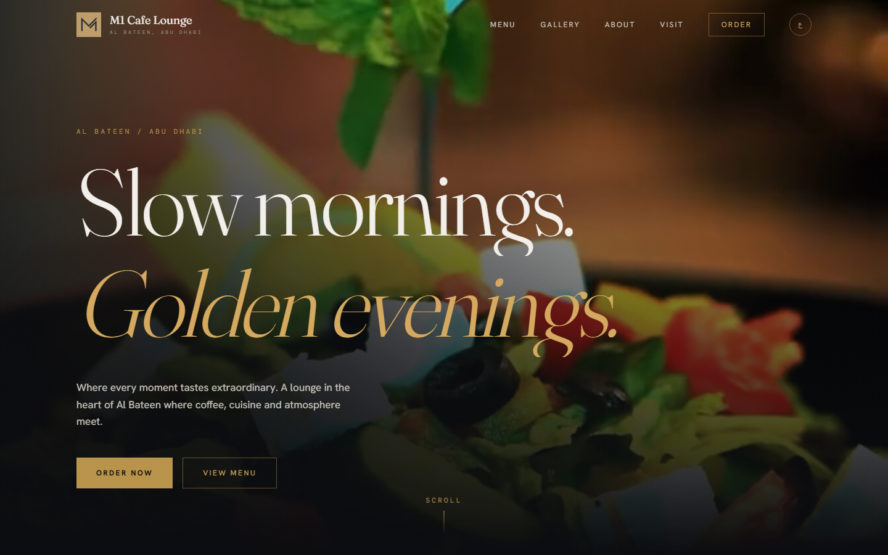

# M1 Cafe Lounge

[](https://m1cafe.farukportfolio.live)


Bilingual (English and Arabic) concept website for M1 Cafe Lounge in Al Bateen, Abu Dhabi.

> **Concept site.** An unofficial study I designed and built to practise hospitality web design. It was not commissioned by M1 Cafe Lounge and is not affiliated with it. The cafe's name and brand belong to its owners.

**Live:** [m1cafe.farukportfolio.live](https://m1cafe.farukportfolio.live)



## Features

- English and Arabic with a language toggle and full right-to-left layout
- Separate Arabic display and body fonts (El Messiri, Tajawal)
- Video hero with a staggered headline reveal
- Menu, gallery, reviews, about and location sections
- Order and WhatsApp buttons, plus a sticky mobile call-to-action bar
- Magnetic buttons and scroll-triggered reveals
- Smooth scroll with Lenis, synced to GSAP ScrollTrigger

## Stack

- Next.js 16 (App Router), React 19, TypeScript
- Tailwind CSS v4
- GSAP + ScrollTrigger
- Lenis
- Fraunces, Hanken Grotesk, DM Mono, El Messiri and Tajawal via `next/font`

## How the translation works

All copy lives in `lib/content.ts` as one object per language. `LanguageProvider` holds the active language, sets `dir` and `lang` on the document, and every section reads its text from the provider, so adding a language means adding one object.

## Run locally

```bash
npm install
npm run dev
```

Open http://localhost:3000.

## My role

Solo concept project: design and development.

## License

No license is granted for the code. All rights reserved by Farouk Battikh. Names, logos and brand assets of the cafe belong to its owners.
